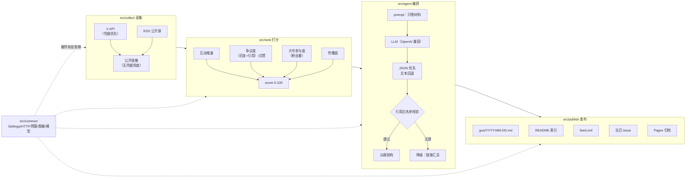

# 🍉 每日一瓜

> 每天北京时间 **09:00**，由 GitHub Actions + LLM Agent 自动发现科技 / AI 圈当天最热的一个「瓜」，
> 整理成**一瓜一页**：一句话摘要、来龙去脉、关键原文（必带原链）、各方立场、未证实标注、吃瓜指数。
> 同时自动开当日 Issue 互动，并更新首页索引与 RSS。

- 一瓜一页：`gua/YYYY-MM-DD.md`（纯 Markdown，天然可版本追溯）
- 当天 Issue：`🍉 每日一瓜 YYYY-MM-DD`，评论即互动（`/more` `/fact-check` `/vote 🍉|🫠`）
- 归档站：GitHub Pages（按日期倒序）+ `feed.xml`（RSS 订阅）
- 合规底线：每条事实附原始链接、推测标注「未证实」、隐私打码、当事人回应优先、更正置顶

## 最新一页

<!-- GUA:INDEX:START -->

**最新一页**：[2026-11-11 · AI 博主称「某知名 AI 博主被大号给爆锤了」，只留一张截图](gua/2026-11-11.md) — 吃瓜指数 76/100（热）

| 日期 | 头条 | 吃瓜指数 | 链接 |
| --- | --- | --- | --- |
| 2026-11-11 | AI 博主称「某知名 AI 博主被大号给爆锤了」，只留一张截图 | 76（热） | [打开](gua/2026-11-11.md) |
<!-- GUA:INDEX:END -->

## 架构

```
                    ┌──────────────────────── GitHub Actions（无服务器）────────────────────────┐
                    │                                                                            │
 cron 09:00 BJT ──▶ │  daily-gua.yml                                                             │
                    │      │                                                                     │
                    │      ▼                                                                     │
                    │  src/collect ──▶ src/rank ──▶ src/agent ──▶ src/publish                     │
                    │   X API 优先      增速+争议度   LLM 生成/校验   gua/*.md · README · feed.xml  │
                    │   公开镜像兜底    +大号权重    JSON 优先      gh issue create 当日 Issue     │
                    │   RSS 兜底         Top1+Top3   失败→链接汇总                               │
                    │      │                                                                     │
                    │      └───── src/common：Secrets 读取 / HTTP 重试 / token 预算 / 脱敏日志 ────┘
                    │
 issue_comment ───▶ │  gua-comment-agent.yml ──▶ src/agent/commands（/more · /fact-check · /vote）
 issues(labeled) ─▶ │  gua-from-issue.yml ────▶ src/cli/from_issue（核查 → 回帖 → 候选池）
 手动触发 ────────▶ │  x-share.yml（只出草稿 + intent 链接）· pages.yml（归档站）· ci.yml（ruff+pytest）
                    └────────────────────────────────────────────────────────────────────────────┘
```



**分层与依赖方向**：`common ← collect ← rank ← agent → publish`（`publish` 不反向依赖 `agent`；
瓜报回读走 `common/frontmatter`，因此无循环依赖）。

| 层 | 职责 | 关键文件 |
| --- | --- | --- |
| `src/common` | 配置与 Secrets、HTTP 超时重试、token 预算、脱敏日志、隐私打码、`Post/Metrics` 模型、瓜报 front matter | `config.py` `http.py` `budget.py` `redaction.py` `privacy.py` `models.py` `frontmatter.py` |
| `src/collect` | X API（关键词/关注列表）、公开镜像兜底、RSS/Atom、通用网页探测 → 统一 `Post` | `x_api.py` `x_mirror.py` `rss.py` `web.py` `service.py` |
| `src/rank` | 指标快照差分算增速、争议度、大号参与度、传播面加权 → Top1 + Top3 备选 | `scorer.py` `snapshots.py` |
| `src/agent` | prompt（只喂材料/强制引用）、LLM 调用、JSON 优先解析、无源降级、瓜报渲染、评论命令 | `llm.py` `prompts.py` `parse.py` `report.py` `render.py` `generate.py` `commands.py` `melons.py` |
| `src/publish` | 落盘、README 索引、feed.xml、当日 Issue（按标题幂等）、Pages 静态站 | `writer.py` `readme.py` `feed.py` `issue.py` `pages.py` |
| `src/cli` | 五个入口，对齐五个 workflow | `daily.py` `from_issue.py` `comment_agent.py` `x_share.py` `pages.py` |

### 打分与吃瓜指数

| 指标 | 计算 | 说明 |
| --- | --- | --- |
| 互动增速 | 有历史快照：`Δ加权互动 / 间隔小时`；无快照：`总加权互动 / 发布至今小时` | 加权互动 = 赞 + 2×转 + 2×回 + 2×引 |
| 争议度 | `(回复 + 1.5×引用) / 点赞`，归一到 0.5 | 回复/引用相对点赞高，才更像「瓜」而不是「热帖」 |
| 大号参与度 | `log10(1+粉丝数)` 归一 | 传播势能代理 |
| 传播面 | `log10(1+阅读量)` 归一 | 流量代理 |
| **排序分** | `0.45×增速 + 0.30×争议度 + 0.15×大号 + 0.10×传播面`（0-100） | 每分量都有上限归一，避免单条爆帖拉爆分布 |
| **吃瓜指数** | `传播面 35 + 讨论热度 30 + 争议度 25 + 新鲜度 10`（0-100，≥85 沸腾 / ≥65 热 / ≥40 温 / 其余微） | **确定性计算**，LLM 只能补充理由、不能改数值 |

## Workflows

| Workflow | 触发 | 作用 |
| --- | --- | --- |
| `daily-gua.yml` | `cron 0 1 * * *`（= 北京 09:00）+ `workflow_dispatch` | 采集 → 打分 → LLM 整理 → 写 `gua/*.md` / `README.md` / `feed.xml` → 开当日 Issue → 提交回仓库 |
| `gua-from-issue.yml` | `issues: opened, labeled`（标签 `gua-submit`）+ `workflow_dispatch` | 核查投瓜链接，回帖「投瓜回执」，通过的进 `state/candidates.json` 次日候选池 |
| `gua-comment-agent.yml` | `issue_comment: created` + `workflow_dispatch` | `/more` 追更、`/fact-check` 核查、`/vote 🍉/🫠` 计票；按 comment id 幂等去重；job 超时 5 分钟 |
| `x-share.yml` | 仅 `workflow_dispatch` | 生成 X 文案 + intent 链接 + `dist/x-draft-<date>.md`，**不自动发帖** |
| `pages.yml` | `push`（`gua/**`、`feed.xml`）+ `workflow_dispatch` | 构建并部署 Pages 归档站 |
| `ci.yml` | `push` / `pull_request` / `workflow_dispatch` | `ruff check .` + `pytest`（全部离线用例） |

> 六个 workflow 均已随本 PR 推送。首次启用仍需维护者在仓库设置中完成：
> Settings → Actions → General → Workflow permissions = `Read and write`；
> Settings → Pages → Source = `GitHub Actions`；配置 Secrets `LLM_BASE_URL` / `LLM_API_KEY` / `LLM_MODEL`（可选 `X_BEARER_TOKEN`）。

## 业务标签（代码自动创建，无需手工建）

| 标签 | 用途 | 谁创建 |
| --- | --- | --- |
| `gua` / `daily-gua` | 当日瓜报 Issue | `daily` 首次运行时幂等创建（`ensure_labels`） |
| `gua-submit` | 投瓜模板标记，`gua-from-issue.yml` 的触发条件 | `daily` / `from-issue` 运行时幂等创建 |
| `gua-accepted` | 投瓜已核实并进入候选池 | `from-issue` 运行时幂等创建 |

> GitHub 的 `POST /issues` 带不存在的标签会返回 **422**，投瓜模板里的 `labels: ["gua-submit"]`
> 会被**静默忽略**。因此 `ensure_labels` 在发帖前先 GET/POST `/labels` 幂等建标；
> 若建标仍失败（无仓库写权限等），建帖会**去标签重试**并把告警写进 CLI 输出（`issue.warnings`），
> 不会让当日出报在 Issue 步骤整体失败。

## 互动命令（在当日 Issue 评论）

| 命令 | 作用 | 说明 |
| --- | --- | --- |
| `/more` | 追更 | 拉取最新公开指标，与上次快照做差分，给出「上次 / 当前 / 增量」表 |
| `/fact-check` | 证据核查 | 对引用链接**逐条实测** HEAD/GET，如实标注可访问 / 不可访问 / 探测超时 / 未探测 |
| `/vote 🍉` 或 `/vote 🫠` | 吃瓜打分 | 🍉 真瓜 / 🫠 假瓜；**每位用户只计一票**（重复投票以最后一次为准），机器人评论不计票 |

## 配置 Secrets（交付后人工执行）

仓库 **Settings → Secrets and variables → Actions**：

| Secret | 必填 | 用途 |
| --- | --- | --- |
| `LLM_BASE_URL` | 建议 | OpenAI 兼容网关地址（如 `https://.../v1`）；缺省时瓜报自动降级为「链接汇总」 |
| `LLM_API_KEY` | 建议 | 上述网关的 key；**只从 Secrets 读取**，不写代码、不写日志 |
| `LLM_MODEL` | 建议 | 模型名，默认 `antigravity/gemini-3.8-flash` |
| `X_BEARER_TOKEN` | 可选 | 有则走 X 官方 API（关键词/关注列表）；缺失则走公开镜像 + RSS 兜底，仍能出报 |

仓库 **Variables**（可选）：`X_KEYWORDS`、`X_HANDLES`、`SEED_URLS`、`RSS_FEEDS`、`SITE_URL`（逗号分隔）。

仓库 **Settings** 里还需要：

1. **Actions → General → Workflow permissions**：选 `Read and write permissions`（daily / comment / from-issue 要提交文件与发帖）；
2. **Pages → Build and deployment → Source**：选 `GitHub Actions`；
3. 首次运行 `pages.yml` 后，站点为 `https://<owner>.github.io/<repo>`（也可用 Variables 里的 `SITE_URL` 覆盖）。

> 这些是**人工配置项**。未配置时：`daily-gua` 仍能产出瓜报（采集走镜像/RSS，正文降级为链接汇总，
> Issue 步骤明确跳过并在输出里说明），不会静默假装成功。

## 本地运行

```bash
git clone https://github.com/hu-qi/daily-gua.git && cd daily-gua
python3.11 -m venv .venv && source .venv/bin/activate
pip install -r requirements-dev.txt          # pytest + ruff（运行时零第三方依赖）

cp .env.example .env      # 填入 LLM_BASE_URL / LLM_API_KEY（.env 已被 .gitignore 忽略）

# 1) 只看效果，不写文件不发帖
python -m src.cli.daily --date 2026-11-11 --dry-run

# 2) 完整本地跑一遍（写 gua/、README、feed.xml、state/；无 GitHub 凭据时自动跳过 Issue）
python -m src.cli.daily

# 3) 强制降级，验证「无 LLM 也能出报」
python -m src.cli.daily --no-llm

# 4) 其他入口
python -m src.cli.comment_agent --issue 1 --comment-id 0 --body "/fact-check" --dry-run
python -m src.cli.from_issue --event event.json --dry-run
python -m src.cli.x_share --date 2026-11-11 --dry-run
python -m src.cli.pages

# 5) 质量门
ruff check . && python -m pytest -q
```

> ⚠️ 常驻命令（如本地起服务看效果）请用一次性脚本或交给 SRE Agent，不要在前台长时间阻塞。

## 目录结构

```
src/
  common/    config.py http.py budget.py redaction.py privacy.py models.py frontmatter.py
  collect/   x_api.py x_mirror.py rss.py web.py service.py
  rank/      scorer.py snapshots.py
  agent/     llm.py prompts.py parse.py report.py render.py generate.py commands.py melons.py
  publish/   writer.py readme.py feed.py issue.py pages.py
  cli/       daily.py from_issue.py comment_agent.py x_share.py pages.py
tests/       离线用例（假传输层 / 假 LLM / 固定时钟）
gua/         每日瓜报（YYYY-MM-DD.md）
state/       snapshots.json（指标快照）· candidates.json（候选池）· handled_comments.json（幂等状态）
.github/     workflows/（5 个 + CI）· ISSUE_TEMPLATE/（投瓜、更正/申诉）
docs/issue-1/ 需求文档 / 方案设计 / 任务拆解
```

## 安全与合规

- **零明文密钥**：密钥只从环境变量（Actions Secrets）读取；日志统一过 `RedactingFilter`，
  已知密钥值与 `Bearer`/`sk-`/`ghp_`/URL token 一律掩码；仓库与 Actions 日志不出现明文。
- **可溯源**：LLM 输出的每个链接都要通过「本次采集材料白名单」校验，伪造链接会被丢弃；
  整份输出若不再引用任何原始链接，自动降级为链接汇总。
- **隐私**：报告与回帖渲染前对手机号 / 座机 / 邮箱 / 身份证号打码；投瓜模板强制「仅公开内容」确认。
- **不点名原则**：材料没点名的人，报告不得替读者指认，只能写「材料未点名」。
- **更正机制**：任何人在当日 Issue 留言更正并提供证据，维护者核查后置顶。

## License

MIT